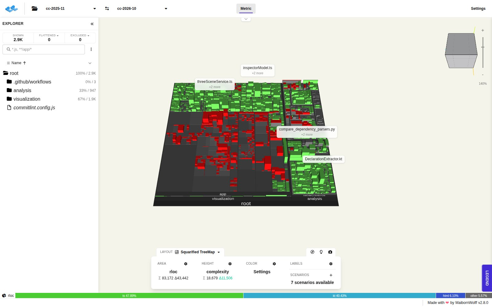
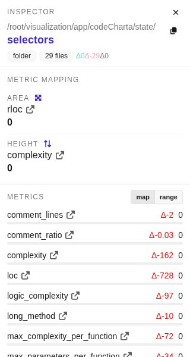

**Compare** shows the difference between two maps instead of a single one. Load two versions of a codebase, such as
the last release and today, and every building is colored by how its metric changed, so growth, clean-ups, new and
removed files stand out.

## Starting Compare

1. Load at least two maps. Select several files at once in the file picker (Shift or Ctrl/Cmd click, as your
   operating system offers), or open them one after the other. See
   [Loading maps](/docs/visualization/user-controls/loading-maps).
2. Point at the **Metric** tab and pick **Compare** in the [mode bar](/docs/visualization/user-controls/views#the-mode-bar).

Compare belongs to the Metric view and is not offered while the map layout is Sunburst or Radial TreeMap. To link
straight to a comparison, add `mode=Delta` to a URL with two `file` parameters; the first map becomes the reference.
See [Visualization URL Parameters](/docs/integrations/visualization-url-params).

**Explore** in the mode bar leaves Compare and shows the maps you had before.

## Selecting the two maps

While Compare is on, the top bar shows two map selectors:

- **Reference** (left): the map you compare from.
- **Comparison** (right): the map you compare to.

The delta is the comparison minus the reference. The swap button between the selectors (**Switch reference and
comparison file**) exchanges them, which turns every increase into a decrease. It is enabled once a comparison map is
picked.

## Reading the delta

In Compare the building colors stand for the change of the **height metric**:

- **Green**: the value increased.
- **Red**: the value decreased.
- **Gray**: unchanged, or flattened.

**Invert colors** in the color settings swaps green and red, for a metric where more is better. The color settings
in Compare offer only the two delta colors, and the [legend](/docs/visualization/user-controls/legend) shows them as
**+Δ positive delta** and **–Δ negative delta**.

The [metric bar](/docs/visualization/user-controls/metrics) shows the change in numbers: next to the sum (Σ) of each
metric comes its delta, for example `Σ 18,679 Δ11,506` for `complexity`.

## Changes in the Inspector

Click a building or a folder to see its changes in the [Inspector](/docs/visualization/user-controls/inspector):

- Every metric shows its change next to its value, such as `Δ-162`, in the delta colors.
- A folder shows how many of its files were added, removed and changed, for example `Δ0 Δ-29 Δ0` for a folder whose
  29 files were all removed.

The [Dependencies view](/docs/visualization/user-controls/dependency-view) shows a single map, so it asks you to leave
Compare first.

## Comparing commits in the desktop app

In the desktop app, with a project open whose folder is a git repository, **Compare** in the mode bar opens the
**Compare** dialog instead of switching between loaded maps:

1. Pick the **Base** and the **Head**: type a branch, tag or commit hash, or choose from the list of branches, tags and
   matching commits. Each side tells whether that commit is analysed. Pasting `main...feature/x` fills both sides.
2. When the base is a branch or tag, choose **Since the merge base** to see only what the head changed since it left
   the base, or **Tip vs tip** to see everything that differs between the two. The dialog remembers the choice for
   the project.
3. Click **Compare** (or press Ctrl+Enter). **Recent** lists the last comparisons of the project; one click fills both
   sides again.

The History offers the same: **Compare** for two selected commits, **Compare with Parent**, **Compare with
Current** and **Compare with…** in a commit's menu, **Compare with '<branch>'** and **Compare with…** in a branch's
menu, and **Compare with HEAD** for the uncommitted changes once the working tree was analysed.

### Another folder, the working tree, an imported map

- **Compare with another folder** gives the head its own folder of the project, for example a fork next to the
  repository. Paths are matched as they are, so a fork with a different layout shows files as removed and added.
  Without a clone that has both commits the comparison is tip vs tip and lists metric changes only.
- The lists of both sides end with **Snapshots**: the three newest analysed working trees and the imported maps of
  the folder (older working trees are in the snapshots dialog). Such
  a side has no commit, so the comparison is tip vs tip and the changed files come from the metrics. The snapshots
  dialog offers the same: **Compare with working tree** on a commit's row and **Compare with…** on the row of a working
  tree or an imported map.

Fetched pull requests stay in your clone until you remove them: **Remove fetched pull requests** in a folder's menu of
the project overview deletes them; they can be fetched again.

### Pull and merge requests

For a folder whose remote is on GitHub or GitLab, the dialog shows a **Pull requests** (GitLab: **Merge requests**)
list next to **Recent**. Enter a request's number, pick the branch it targets and click **Open**: CodeCharta fetches the
request's head into a private ref of your clone (`refs/codecharta/pr/<number>`, never a branch) and compares it from
where it left the target branch. When the GitHub CLI (`gh`) or the GitLab CLI (`glab`) is missing, the list says so
and links to the desktop tools; when the CLI works but the requests cannot be listed yet, the list says "Pull requests
cannot be listed here. Enter a number to open one." A host CodeCharta does not recognise can be named as
GitHub Enterprise or GitLab once.

### Changed files

While comparing, the explorer offers a **Changes** mode: it sums up how many files were added, removed and changed and
how the area and height metrics moved, and lists the files git changed between the two commits (or, when no clone has
both commits, the files whose metrics changed). Click a row to select its building, or the crosshair to focus its
folder. **Only changed files** greys out and flattens every other building. A row's height delta takes the delta
colors, inverted when **Invert colors** is on. The inspector shows the git change of the selected file as a badge, and
for a renamed file its old path, for example "renamed from src/old.ts".

While comparing, the top bar shows one compact button that names both sides, for example `main → feature/x`; a yellow
dot says a side is shown by its nearest analysis, and a pull request icon marks a pull request comparison. Its tooltip
names each side with its commit (and its folder when two folders are compared). Click it for the details: each side
with its commit, whether it is analysed or how stale it is, and **Change…**; **Swap base and head**; the pull request's
link; **Copy as text**; and **Leave compare**, which keeps the head on the map. An imported side is named by the day it
was imported. In a window narrower than 1280 px the project menu shows only its icon while comparing.
